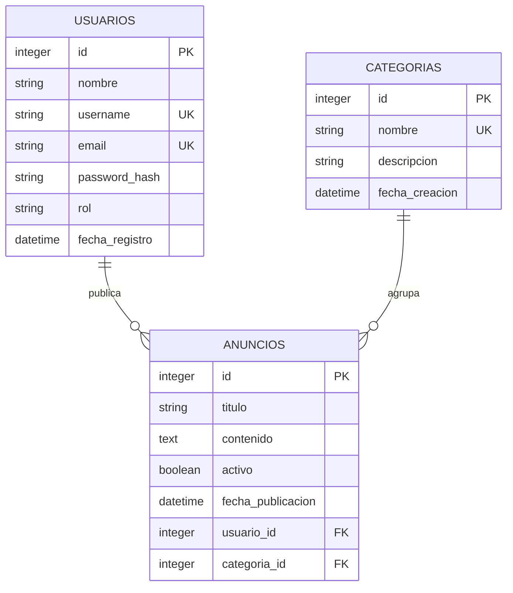

# Tablón de Anuncios

Aplicación web desarrollada con Flask para gestionar un tablón de anuncios institucional. Implementa el patrón **Application Factory**, organización modular con **Blueprints**, base de datos **SQLite** mediante **Flask-SQLAlchemy** y una interfaz responsive construida con **Bootstrap 5**.


## Características

- Autenticación con inicio de sesión, registro y cierre de sesión.
- Contraseñas almacenadas con hash seguro mediante Werkzeug.
- Administración completa de usuarios, categorías y anuncios.
- Roles de usuario: administrador y usuario.
- Anuncios asociados a una categoría y a un autor.
- Búsqueda, filtros por categoría y estado, y paginación.
- Protección de rutas y validación de permisos por autor o administrador.
- Interfaz con cabecera institucional, menú de navegación, contenido y pie de página.
- Páginas de error personalizadas para 403 y 404.

## Tecnologías

| Componente | Tecnología |
|---|---|
| Lenguaje | Python 3.11+ |
| Framework web | Flask 3.1 |
| Base de datos | SQLite |
| ORM | Flask-SQLAlchemy 3.1 |
| Autenticación | Flask-Login |
| Interfaz | Bootstrap 5.3 y Bootstrap Icons |
| Servidor de desarrollo | Werkzeug |

## Estructura del proyecto

```text
Tablon de anuncios/
├── app/
│   ├── __init__.py
│   ├── decorators.py
│   ├── extensions.py
│   ├── models.py
│   ├── blueprints/
│   │   ├── auth/
│   │   ├── main/
│   │   ├── usuarios/
│   │   ├── categorias/
│   │   └── anuncios/
│   ├── static/
│   │   └── css/estilos.css
│   └── templates/
│       ├── auth/
│       ├── usuarios/
│       ├── categorias/
│       ├── anuncios/
│       ├── errores/
│       └── base.html
├── database/schema.sql
├── instance/bd_anuncios.db
├── config.py
├── run.py
├── requirements.txt
└── .flaskenv
```

## Diseño de la base de datos

Base de datos: **bd_anuncios**



### Relaciones

- Un usuario puede publicar muchos anuncios: `usuarios.id` → `anuncios.usuario_id`.
- Una categoría puede agrupar muchos anuncios: `categorias.id` → `anuncios.categoria_id`.
- Cada anuncio pertenece obligatoriamente a un usuario y a una categoría.
- La eliminación de usuarios o categorías con anuncios asociados se bloquea desde la aplicación para preservar la integridad referencial.

El script DDL completo se encuentra en `database/schema.sql`.

## Instalación

```bash
cd "Tablon de anuncios"

python3 -m venv .venv
source .venv/bin/activate

pip install -r requirements.txt
```

## Inicialización de la base de datos

```bash
flask init-db
```

El comando crea las tablas y carga datos de demostración:

- Usuario administrador: `admin`
- Contraseña: `admin123`
- Categorías: Académico, Eventos, Deportes, Tecnología y General.
- Tres anuncios de ejemplo.

La base de datos se genera en `instance/bd_anuncios.db`.

## Ejecución

```bash
flask run
```

Abrir en el navegador: `http://127.0.0.1:5000`

También es posible ejecutar directamente:

```bash
python run.py
```

## Rutas principales

| Método | Ruta | Descripción | Acceso |
|---|---|---|---|
| GET | `/` | Página principal y buscador | Público |
| GET/POST | `/auth/login` | Inicio de sesión | Público |
| GET/POST | `/auth/registro` | Registro de usuario | Público |
| GET | `/auth/logout` | Cierre de sesión | Autenticado |
| GET | `/anuncios/` | Listado y filtros de anuncios | Público |
| GET | `/anuncios/<id>` | Detalle del anuncio | Público |
| GET/POST | `/anuncios/nuevo` | Publicar anuncio | Autenticado |
| GET/POST | `/anuncios/<id>/editar` | Editar anuncio | Autor o administrador |
| POST | `/anuncios/<id>/estado` | Activar o desactivar anuncio | Autor o administrador |
| POST | `/anuncios/<id>/eliminar` | Eliminar anuncio | Autor o administrador |
| GET | `/categorias/` | Listado de categorías | Administrador |
| GET/POST | `/categorias/nueva` | Registrar categoría | Administrador |
| GET/POST | `/categorias/<id>/editar` | Editar categoría | Administrador |
| POST | `/categorias/<id>/eliminar` | Eliminar categoría | Administrador |
| GET | `/usuarios/` | Listado de usuarios | Administrador |
| GET/POST | `/usuarios/nuevo` | Registrar usuario | Administrador |
| GET/POST | `/usuarios/<id>/editar` | Editar usuario | Administrador |
| POST | `/usuarios/<id>/eliminar` | Eliminar usuario | Administrador |

## Cuentas de prueba

| Rol | Usuario | Contraseña |
|---|---|---|
| Administrador | `admin` | `admin123` |

Los usuarios registrados desde el formulario público obtienen el rol `usuario`, por lo que pueden publicar y administrar sus propios anuncios, pero no acceder a la gestión de usuarios y categorías.

## Reglas de negocio

- Solo el administrador gestiona usuarios y categorías.
- Un usuario autenticado puede publicar anuncios.
- Un anuncio solo puede ser editado, activado, desactivado o eliminado por su autor o por un administrador.
- Los anuncios inactivos no se muestran al público.
- No se puede eliminar la propia cuenta ni quitarse el rol de administrador.
- No se eliminan usuarios ni categorías que tengan anuncios asociados.
- Los nombres de usuario, correos y categorías son únicos.

## Documento de la actividad

- Informe en PDF: `Documento_Actividad_04_Tablon_de_Anuncios.pdf`
- Fuente editable del informe: `docs/informe.html`
- Capturas de pantalla: `docs/capturas/`

El informe incluye el diseño de la base de datos, las tablas y relaciones, la estructura del proyecto, la arquitectura, las rutas y capturas de la aplicación. Antes de la entrega se deben completar en la portada el nombre del estudiante y la URL del repositorio, y luego exportar nuevamente el documento a PDF desde el navegador.
# Tablon-de-anuncios
